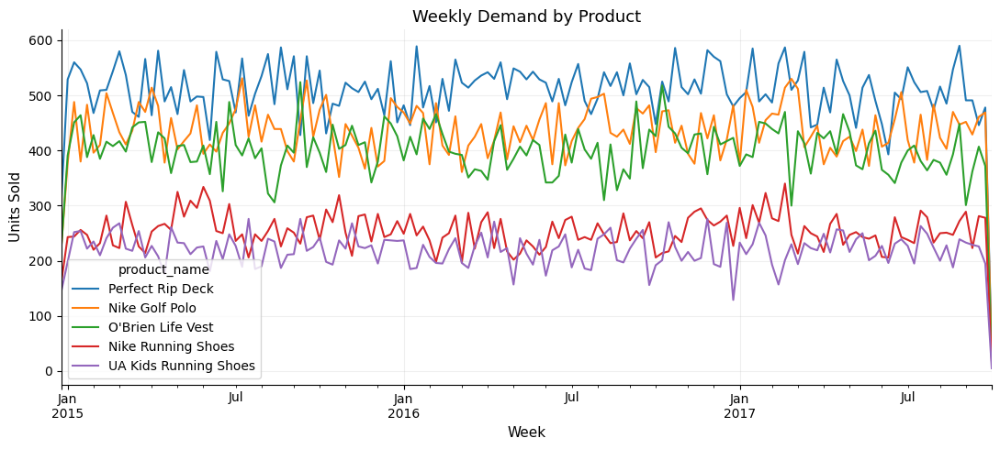
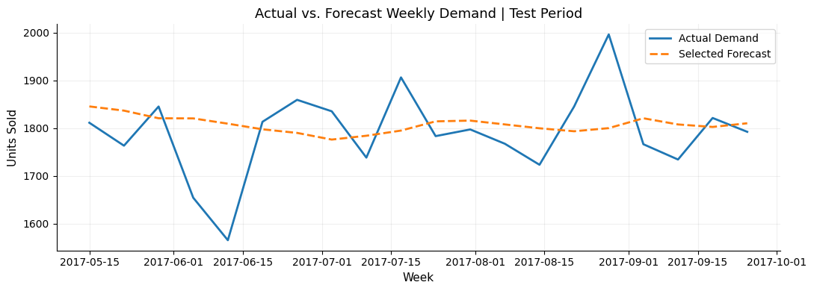
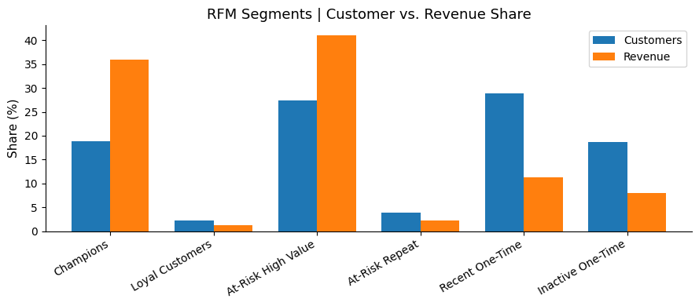
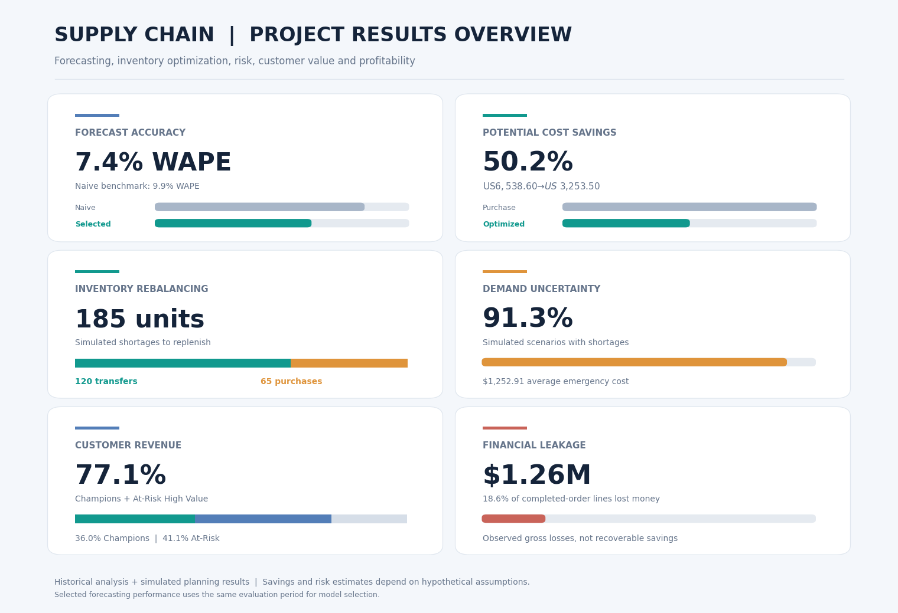

# Supply Chain Analytics: Demand Forecasting, Inventory Optimization & Operational Research

*An end-to-end business analytics case study combining demand forecasting, mathematical optimization, and risk analysis to support retail inventory decisions.*

**Author:** Vanessa Donato  
**Dataset:** DataCo Smart Supply Chain (Kaggle) · 180,519 order lines · 53 original columns  
**Tools:** Python · Google Colab · Pandas · NumPy · Statsmodels · PuLP · MLflow · Matplotlib · Seaborn  
**Methods:** EDA · Walk-Forward Forecasting · Integer Linear Programming · Monte Carlo Simulation · RFM Segmentation · Profitability Analysis · LLM Response Evaluation

---

## Key Results

| Area | Result | Business relevance |
|---|---|---|
| Demand Forecasting | **7.4% WAPE** | Selected product-level forecasts compared with a **9.9%** Naive benchmark |
| Inventory Optimization | **50.2% potential savings** | Simulated replenishment cost reduced from **$6,538.60** to **$3,253.50** |
| Inventory Allocation | **120 transfers + 65 purchases** | Proposed response to **185 shortage units** in a simulated scenario |
| Demand Risk | **91.3%** | Share of Monte Carlo scenarios with at least one shortage |
| Customer Retention | **77.1% of revenue** | Revenue contributed by Champions and At-Risk High Value customers |
| Financial Leakage | **$1.26M in gross losses** | Negative profit across **18.6%** of completed-order lines |

*Important: Inventory quantities, replenishment costs, savings, and risk scenarios are simulated. Customer and profitability findings describe historical transactions. The selected forecasting approach was assessed on the same 20-week period used for model selection, so its reported accuracy may be optimistic.*

---

## Business Context

Retail supply chains must balance demand, product availability, transportation costs, and replenishment decisions across markets. Purchasing more inventory can solve local shortages, but it may also create unnecessary costs when other locations hold excess stock.

Using the DataCo Smart Supply Chain dataset, this project examines how analytical methods can support these decisions. **Inventory optimization is the main business problem**; customer retention and profitability are complementary areas of investigation.

### Three Business Questions

1. **Inventory Planning:** How can we redistribute available stock and reduce the cost of meeting forecast demand?
2. **Customer Retention:** Which customers should be prioritized for loyalty and re-engagement initiatives?
3. **Financial Leakage:** Where are negative-profit transactions concentrated, and what should be investigated first?

### Business Problem Overview


*Historical observations show 57.3% late-delivery order lines, 55.3% one-time buyers among customers with completed orders, and 18.6% negative-profit completed-order lines. The forecasting benchmark and inventory imbalance are modeling inputs, not observed warehouse performance.*

---

## Dataset & Analytical Scope

The source dataset contains **180,519 order lines** and **53 original columns**, covering transactional information about products, customers, orders, sales, profitability, and shipping.

The analysis uses these records for historical business diagnosis. For inventory planning, **warehouse stock balances, supplier purchase prices, and regional transfer costs are not available**. Those inputs are therefore defined as explicit hypothetical assumptions rather than presented as actual DataCo operations.

The forecasting stage focuses on **five products**, while the inventory optimization POC allocates a share of the resulting forecasts to **four selected regions**. The RFM and financial analyses use **COMPLETE** orders to focus on confirmed completed transactions.

## Analytical Workflow

```text
Data preparation and validation
    → Business diagnosis and EDA
    → Product-level demand forecasting
    → Regional demand allocation
    → Inventory optimization and cost comparison
    → Monte Carlo risk analysis
    → RFM customer segmentation and profitability analysis
    → Business recommendations and reusable outputs
```

---

## 1. Business Diagnosis & Exploratory Analysis

Historical analysis identified several operational and financial challenges:

- **57.3% of order lines** were associated with late delivery. Monthly late-delivery rates were relatively stable, suggesting the issue was not explained by a single seasonal peak.
- **55.3% of customers with completed orders** purchased only once during the observed period.
- **18.6% of completed-order lines** reported negative profit.

Late delivery is an observed shipping outcome, but the data does **not** establish that inventory shortages caused these delays. The subsequent inventory model is a separate, simulated planning exercise.

---

## 2. Demand Forecasting

Five high-volume products were modeled using **143 complete weeks** of sales history, after excluding two incomplete boundary weeks. The last **20 weeks** were reserved for one-week-ahead walk-forward evaluation.

### Historical Product Demand



*Weekly sales histories were aggregated at product level to avoid treating uneven regional coverage as changes in demand.*

### Forecasting Model Comparison

| Forecasting method | Overall WAPE |
|---|---:|
| Naive | 9.9% |
| 4-week Moving Average (MA4) | 8.2% |
| Simple Exponential Smoothing (SES) | 7.5% |
| **Selected method per product** | **7.4%** |

SES performed best for four products, while MA4 performed best for O'Brien Life Vest. The selected approach combined the best-performing method for each product.



*Actual and predicted weekly demand during the 20-week evaluation window. Sudden fluctuations remain challenging even when the overall error is relatively low.*

The final one-week forecast totaled **1,796 units** across all recorded sales regions. Historical product-region sales shares were then used to allocate **818 units** to the four regions selected for inventory planning. This regional allocation is an assumption, **not an independently validated regional forecast**.

**Validation caveat:** The 7.4% WAPE uses the same test period for model selection and evaluation. It is a useful model-comparison result, but an independent holdout period would be needed for an unbiased estimate of future performance.

---

## 3. Inventory Optimization & Replenishment POC

### Simulated Planning Scenario

Forecast-based regional demand was compared with hypothetical inventory availability:

| Inventory indicator | Units |
|---|---:|
| Forecast demand across four regions | 818 |
| Simulated available stock | 753 |
| Gross shortage | **185** |
| Gross surplus | **120** |
| Minimum new purchases after feasible redistribution | **65** |

An **Integer Linear Programming** model built with PuLP minimizes incremental purchasing and transfer costs while meeting demand for every product and region. Purchase costs and transfer routes are simulated; eligible transfers must fit the one-week planning horizon.

### Purchasing Only vs. Optimized Replenishment

| Strategy | Transfers | Purchases | Simulated cost |
|---|---:|---:|---:|
| Purchasing only | 0 | 185 | **$6,538.60** |
| Optimized plan | **120** | **65** | **$3,253.50** |

**Potential savings: $3,285.10 (50.2%)** under the modeled assumptions.

The optimized transfer plan recommends **62 units from South America to Central America** and **58 units from Northern Europe to Western Europe**. These quantities and costs are illustrative, not real warehouse instructions or realized financial savings.

### Reusable Optimization POC

The original optimization was packaged into a reusable function accepting inventory, purchase-cost, and transfer-route inputs. Its validation reproduced the original optimal solution, including the **$3,253.50** total cost, **120 transfers**, and **65 purchases**.

The POC exports six CSV deliverables: `inventory_scenario.csv`, `purchase_costs.csv`, `transfer_routes.csv`, `transfer_plan.csv`, `purchase_plan.csv`, and `cost_summary.csv`.

These outputs allow the assumptions and resulting decisions to be inspected without relying only on the notebook's printed results.

---

## 4. Monte Carlo Risk Analysis

The optimized replenishment plan was stress-tested under uncertain demand using **1,000 simulated scenarios**, informed by historical forecast errors.

- **91.3%** of scenarios contained at least one stock shortage.
- Average shortage was **27.4 units**; the 90th percentile was **56 units**.
- Average hypothetical emergency replenishment cost was **$1,252.91**.

The result highlights why a low-cost plan based on point forecasts should also be evaluated for risk. The simulation uses simplified assumptions and does not imply that these shortages or expenses occurred in DataCo's real operations.

---

## 5. Customer Retention Analysis

RFM segmentation used **21,716 completed orders** from **12,523 customers**, based on recency, purchasing frequency, and monetary value.

- **44.7%** of these customers had at least two completed orders.
- **Champions:** 18.9% of customers, generating **36.0%** of completed-order revenue.
- **At-Risk High Value:** 27.3% of customers, generating **41.1%** of completed-order revenue.
- Together, the two segments contributed **77.1%** of revenue.



*Customer share versus revenue share by RFM segment. The "At-Risk" label describes historical recency, not verified churn.*

The findings suggest prioritizing re-engagement of historically valuable customers, strengthening loyalty among Champions, and encouraging second purchases among recent one-time buyers.

---

## 6. Financial Leakage Analysis

Among **59,491 completed-order lines**, **11,079 (18.6%)** generated negative profit, totaling **$1,264,213.06** in gross losses. These losses offset **48.9%** of gross positive profit.

The five categories with the highest losses accounted for **60.9%** of total gross losses. Fishing contributed the largest individual category amount (**$235,616.63**).

Higher discount bands were associated with slightly higher negative-profit rates and lower margins, but the differences were modest. This is a **descriptive association, not evidence that discounts caused the losses**. Gross losses also should not be interpreted as amounts that can necessarily be recovered.

---

## Project Results Overview



*Executive visual summary of forecast accuracy, simulated replenishment savings, inventory redistribution, demand uncertainty, customer revenue concentration, and observed profitability losses.*

---

## Prioritized Business Recommendations

**1. Test regional inventory redistribution before purchasing more stock.** Use demand forecasts and product-specific stock balances to identify transfers that are feasible and less costly than new purchases. Validate the simulated cost assumptions before operational use.

**2. Incorporate uncertainty into replenishment planning.** Evaluate safety-stock or contingency policies alongside optimized point-forecast plans, especially where emergency purchasing could be expensive. Validate forecasting performance on an independent period.

**3. Protect high-value customers and investigate financial leakage.** Prioritize retention experiments for Champions and At-Risk High Value segments, and review recurring loss-making products, pricing, discounts, and cost assumptions before changing commercial policies.

---

## Technical Implementation & Additional Deliverables

### MLflow Experiment Tracking

Four forecasting approaches (**Naive, MA4, SES, and Selected Models**) were logged in MLflow with evaluation settings and MAE/WAPE metrics. The summary is available in `outputs/mlflow_forecast_results.csv`; the local experiment database was also backed up separately.

### Inventory Optimization POC

The reusable PuLP function reproduces the optimization result and generates six auditable CSV inputs and outputs in `outputs/inventory_poc/`. It is a **decision-support proof of concept**, not a production inventory system.

### LLM Response Evaluation

A supplementary case compared **Claude and ChatGPT** responses to the same business recommendation prompt using five criteria: accuracy, groundedness, clarity, actionability, and limitations. The qualitative scores were **23/25** and **24/25**, respectively, for this single prompt. The evaluation is not a general model benchmark or a fully blinded study.

See [LLM Evaluation Case](llm_evaluation/llm_evaluation_case.md) for the prompt, original responses, scoring, and feedback.

---

## Limitations

- **Inventory and costs:** Warehouse balances, purchase prices, transfer costs, and lead times are hypothetical; the **50.2% savings** are not realized results.
- **Forecast validation:** Product-level models were selected using the same evaluation period on which the final **7.4% WAPE** was reported; regional demand was allocated using historical shares.
- **Risk simulation:** Monte Carlo estimates depend on a limited history of forecasting errors and simplified operational assumptions.
- **Customer and financial analysis:** RFM segments do not establish churn, and profitability patterns do not establish causal drivers or recoverable savings.
- **Implementation:** The POC and MLflow logs demonstrate reproducibility and experiment organization, not a deployed production pipeline.

## Next Steps

- Replace simulated stock, acquisition costs, and logistics routes with real operational inputs.
- Validate forecasts on an independent period and assess product-region forecasting performance.
- Compare optimized replenishment, safety-stock policies, and emergency purchasing under consistent risk scenarios.
- Test customer retention initiatives and investigate product-level profitability drivers.

---

## Repository Structure

```text
supply-chain-analytics/
├── README.md
├── notebooks/
│   └── supply_chain_analysis.ipynb
├── Images/
│   ├── business_problem_overview.png
│   ├── weekly_product_demand.png
│   ├── actual_vs_forecast.png
│   ├── rfm_segments.png
│   └── project_results_dashboard.png
├── outputs/
│   ├── mlflow_forecast_results.csv
│   └── inventory_poc/
│       ├── inventory_scenario.csv
│       ├── purchase_costs.csv
│       ├── transfer_routes.csv
│       ├── transfer_plan.csv
│       ├── purchase_plan.csv
│       └── cost_summary.csv
├── llm_evaluation/
│   └── llm_evaluation_case.md
└── requirements.txt
```

## Reproducing the Analysis

The main analysis was developed in **Google Colab**. To run the notebook, obtain the DataCo Smart Supply Chain dataset from Kaggle, install the dependencies listed in `requirements.txt`, and update the dataset path (`file_path`) to match your environment. Execute the notebook from top to bottom.

The inventory POC outputs and the MLflow experiment summary are included as reference deliverables. Some steps currently save files to Google Drive and may require adapting the output directories outside Colab.

---

## Conclusion

The project combines forecasting, optimization, simulation, customer segmentation, and financial analysis to connect analytical findings with business decisions. The inventory POC demonstrates **potential cost savings under a clearly defined simulated scenario**, while the historical customer and profitability analyses identify additional areas for investigation.

Beyond the analytical results, MLflow tracking, reusable optimization outputs, and structured LLM response evaluation provide practical examples of transparent and reproducible analytical work.

