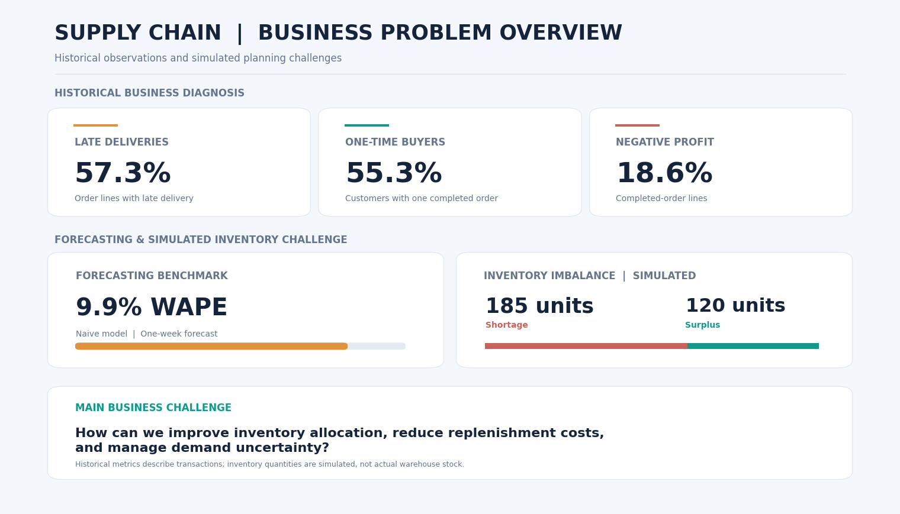

# Supply Chain Analytics: Demand Forecasting, Inventory Optimization & Operational Research

*An end-to-end business analytics project combining demand forecasting, mathematical optimization, and risk simulation to support retail inventory decisions.*

**Dataset:** DataCo Smart Supply Chain (Kaggle) · 180,519 order lines · 53 original variables

**Methods:** Exploratory Data Analysis · Demand Forecasting · Walk-Forward Validation · Linear Programming · Monte Carlo Simulation · RFM Segmentation · Profitability Analysis

**Tools:** Python · Pandas · NumPy · Statsmodels · PuLP · MLflow · Matplotlib · Seaborn · Google Colab

---

## Key Results

| Area | Main Result | Business Insight |
|---|---|---|
| Demand Forecasting | **7.4% WAPE** | Product-level model selection improved on the 9.9% Naive benchmark |
| Inventory Optimization | **50.2% potential savings** | Simulated replenishment costs decreased from $6,538.60 to $3,253.50 |
| Inventory Allocation | **120 transfers + 65 purchases** | Replenishment plan addressing 185 simulated shortage units |
| Risk Analysis | **91.3% of scenarios with shortages** | Demand uncertainty creates exposure to emergency replenishment |
| Customer Retention | **77.1% of revenue** | Champions and At-Risk High Value customers account for most completed-order revenue |
| Financial Leakage | **$1.26M in gross losses** | 18.6% of completed-order lines generated negative profit |

*Inventory levels, replenishment costs, and optimization savings are simulated. Customer and profitability findings are based on historical transactions. Forecasting performance was evaluated on the same period used for model selection.*

---

## Business Context

Retail supply chains must balance product availability, replenishment costs, and uncertain demand across different markets.

When some locations face shortages while others have excess stock, purchasing additional inventory is not always the most efficient solution. Redistributing existing inventory may reduce costs, but transportation expenses, lead times, and demand uncertainty must also be considered.

This project uses historical DataCo transactions to investigate these challenges and develop a simulated inventory optimization scenario.

### Business Problems

The analysis addresses three main questions:

1. **Inventory Planning:** How can stock be allocated more efficiently while minimizing replenishment costs?
2. **Customer Retention:** Which customer segments should be prioritized for loyalty and re-engagement?
3. **Financial Leakage:** Where are negative-profit transactions concentrated, and what opportunities should be investigated?

### Business Problem Overview

*Historical business indicators reveal delivery delays, low repeat-purchase frequency, and negative-profit transactions. The simulated inventory scenario highlights shortages and surpluses across four regional locations.*

---

## Analytical Workflow

The project follows a practical decision-making process:

**Data Preparation → Business Diagnosis → Demand Forecasting → Inventory Optimization → Risk Analysis → Customer & Profitability Insights → Business Recommendations**

The main analysis focuses on inventory planning, while customer retention and financial leakage provide complementary business perspectives.
